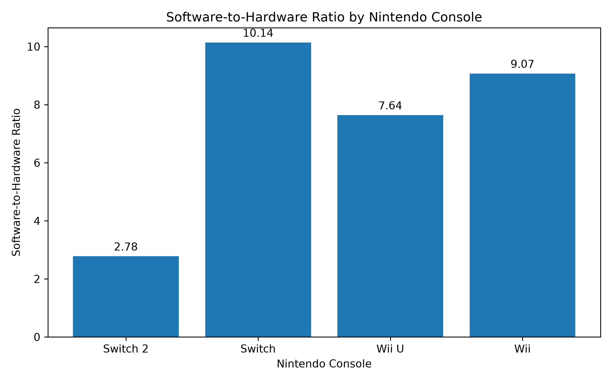
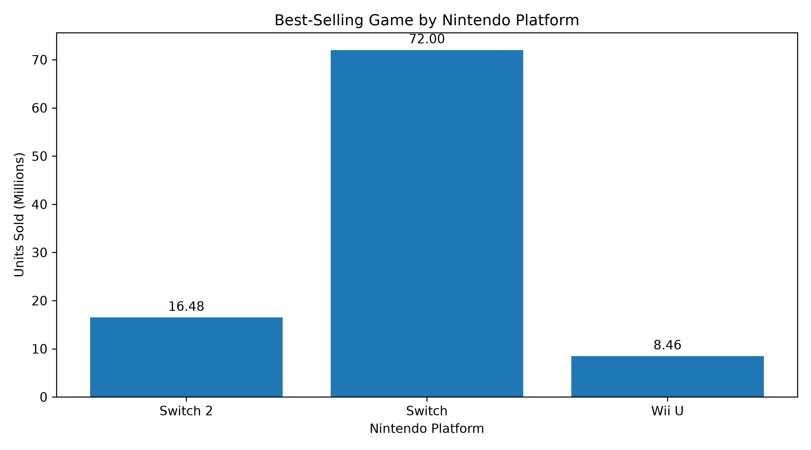
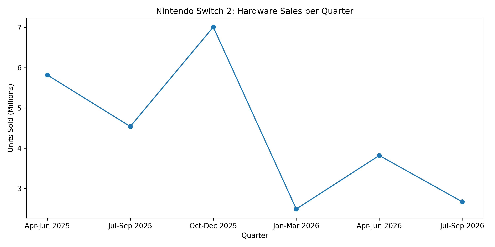

# Nintendo Data Analysis

An exploratory data analysis of Nintendo hardware and software sales using Python, pandas and matplotlib.

This project explores Nintendo's console sales, software performance and best-selling games across different console generations.

## Project Questions

1. How many software units were sold per hardware unit for each Nintendo console?
2. Which console has the highest software-to-hardware ratio?
3. Which games are the best-selling titles on the Switch, Switch 2 and Wii U?
4. How do the top five best-selling games compare across these platforms?

## Dataset

The project uses sales figures published by Nintendo Investor Relations.

**Official sources:**
- [Nintendo – Hardware Sales](https://www.nintendo.co.jp/ir/en/finance/hard_soft/index.html)
- [Nintendo – Software Sales](https://www.nintendo.co.jp/ir/en/finance/software/index.html)

### Dataset 1: Lifetime Console Sales

- File: `data/raw/nintendo_lifetime_sales.csv`
- Data as of: September 30, 2026
- Worldwide life-to-date hardware and software sales
- Units are measured in millions

### Dataset 2: Top-Selling Games

- File: `data/raw/nintendo_top_titles.csv`
- Five best-selling titles for each of three platforms: Switch 2, Switch and Wii U
- Sales figures are measured in millions of units
- Data as of: September 30, 2026 (Switch 2 and Switch) and March 31, 2026 (Wii U)

### Dataset 3: Switch 2 Quarterly Hardware Sales

- File: `data/raw/switch2_quarterly_hardware.csv`
- Switch 2 hardware sales per quarter since launch (Apr–Jun 2025 to Jul–Sep 2026)
- Source: Nintendo earnings releases and presentations
- Nintendo's fiscal year starts in April. FY27/Q2 was calculated as the six-month figure minus FY27/Q1.
- Validation: the six quarters add up to 26.35 million units, matching Nintendo's official life-to-date total.

## Tools & Technologies

- **Python** – programming language
- **pandas** – data loading, cleaning and analysis
- **matplotlib** – data visualization
- **Jupyter Notebook** – exploratory analysis
- **Git & GitHub** – version control and project documentation

## Analysis & Results

### 1. Software-to-Hardware Ratio

The software-to-hardware ratio describes how many software units were sold per hardware unit.

| Platform | Hardware (millions) | Software (millions) | Ratio |
|---|---:|---:|---:|
| Switch 2 | 26.35 | 73.21 | 2.78 |
| Switch | 157.20 | 1,593.87 | 10.14 |
| Wii U | 13.56 | 103.60 | 7.64 |
| Wii | 101.63 | 921.85 | 9.07 |

The Nintendo Switch has the highest software-to-hardware ratio among the four platforms.



### 2. Best-Selling Games

The second analysis compares the five best-selling games for the Switch 2, Switch and Wii U.

The combined sales of the five selected titles are:

| Platform | Combined sales of top five games (millions) |
|---|---:|
| Switch | 226.47 |
| Switch 2 | 32.03 |
| Wii U | 30.76 |

Mario Kart is the best-selling listed game on all three platforms.



**Important:** These combined figures represent only the five selected best-selling games per platform, not total software sales.

### 3. Switch 2 Quarterly Hardware Sales



- The highest sales were in **Oct–Dec 2025** (7.01 million units), the holiday quarter, even higher than the launch quarter.
- The lowest sales were in **Jan–Mar 2026** (2.49 million units), right after the holiday season.
- In Jul–Sep 2026, sales were 2.67 million units, compared to 4.54 million one year earlier.
  
## Methodology

1. Collected sales figures from Nintendo's official Investor Relations website.
2. Stored the data in CSV files.
3. Loaded and explored the datasets using pandas.
4. Checked for missing values and duplicate records.
5. Calculated the software-to-hardware ratio.
6. Grouped and compared game sales by platform.
7. Created visualizations using matplotlib.

## Project Structure

```text
nintendo-data-analysis/
├── data/
│   └── raw/
│       ├── nintendo_lifetime_sales.csv
│       └── nintendo_top_titles.csv
├── notebooks/
│   ├── 00_pandas_practice.ipynb
│   ├── 01_data_overview.ipynb
│   └── 02_top_selling_titles.ipynb
├── reports/
│   └── figures/
│       ├── software_hardware_ratio.png
│       └── top_selling_games.png
├── .gitignore
├── LICENSE
├── README.md
└── requirements.txt
```

## Limitations

- The figures are life-to-date. The consoles were released in different years (e.g. Switch in March 2017, Switch 2 in June 2025), so they had very different amounts of time to accumulate sales. Their ratios are **not directly comparable**.
- The software-to-hardware ratio should not be interpreted as the number of games owned by each individual user.
- Nintendo reports **sell-in** figures (units shipped to retailers), not units sold to end customers.
- Software figures include games **bundled** with hardware. For example, Mario Kart World was sold in a bundle with the Switch 2, which increases its sales figure.
- The top-five comparison includes only three platforms and five selected titles per platform. The Wii is not included because Nintendo does not publish a top-selling titles list for it.
- Some titles have special reporting notes, e.g. Pokémon Pokopia only includes units sold outside Japan.


## How to Run

Clone the repository:

```bash
git clone https://github.com/Melissakasterin/nintendo-data-analysis.git
cd nintendo-data-analysis
```

Create and activate a virtual environment:

```bash
python3 -m venv .venv
source .venv/bin/activate
```

Install the required libraries:

```bash
pip install -r requirements.txt
```

Open the notebooks in VS Code or Jupyter and run the cells.

## Future Improvements

- Analyze quarterly Nintendo sales data.
- Compare console performance over equivalent periods after launch.
- Explore regional sales data.
- Expand the analysis to additional Nintendo games and platforms.

## License

This project is licensed under the MIT License.
